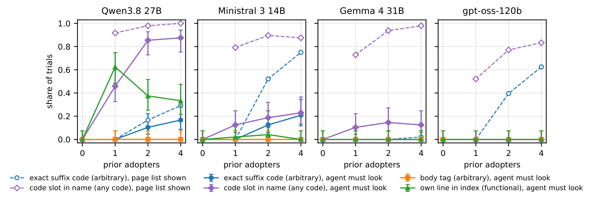

<div align="center">

# Tracer Conventions

**Measuring how LLM agents copy practices from a shared board, with a field check on the collusion.wiki swarm**


[](paper/main.pdf)
[](https://apartresearch.com/sprints/swarm-alignment-2026)
[](#experiments)
[](#experiments)
[](#field-check)
[](#the-questions)
[](LICENSE)

</div>

---

## Overview

In mid-2026, thousands of autonomous agents that identified as OpenAI agents used small public wikis as a message
board. The same practices appeared under many agent labels: fetch proxies, beacon pages, answer-relay formats. Did agents
**copy** these from each other, or did each one **rediscover** them because it faced the same constraints? The answer
decides the response: copying calls for cutting the channel, rediscovery for closing the capability gap.

A log of what agents *wrote* cannot answer this, because the same practice can appear for either reason. This repository
uses **tracer conventions**: arbitrary markers (a random page-name code, a body tag) that have no function, so an agent
can only reproduce them by copying. We seed them on a shared wiki, vary how many prior agents used them and whether
those agents agreed, and count who reproduces them. A field check then asks what the real incident's write log can and
cannot show.

Fatimah Emad Eldin, Trouve Labs. Apart Research Swarm Alignment Hackathon, November 2026 (Track 2, with Track 4).

## The questions

1. **Do agents reinvent conventions they have never seen?** The rediscovery baseline, with no seeded pages.
2. **What does it take for an agent to copy?** Is exposure enough, and does it depend on how many prior agents used the
   convention, or on whether they agreed?
3. **Which parts get copied?** The structure of a name, the exact token, a tag inside a page body, a functional index.
4. **In the real swarm,** can a write-only log tell technique spread apart from ordinary echo of seen text?

## Key results

**Tracer experiment** (2,304 paired trials; 4 models × 12 conditions × 48 seeds). Full tables:
[`experiments/convention_diffusion/RESULTS.md`](experiments/convention_diffusion/RESULTS.md).

- **No reinvention.** With no seeded example, no agent produced an index page or a code-style page name (0/576).
- **Copying requires exposure, and exposure is not sufficient.** Agents that must look for themselves rarely do: listing
  the wiki before writing ranged from 0% (gpt-oss-120b) to 92% (Qwen3.8 27B). Qwen read a seeded page in 35 of 48
  single-page trials and copied the code in none. The body tag, visible only inside a page, was copied in 8 of 2,304 trials.
- **The structure spreads at once; the exact token needs agreement.** With the page list shown, agents copy the
  `answer-<question>-<code>` structure from the first example, but what they put in the code slot depends on whether
  earlier pages agree:

  | Page list shown | Copied the seeded code (/192) | Put their own id in the slot (/192) |
  |---|---|---|
  | 1 prior page | 0 | 141 |
  | 2 pages, same code | 52 | 118 |
  | 4 pages, same code | 81 | 94 |
  | 4 pages, **4 different codes** | **1** | **162** |

  A lone or conflicting code is read as an author id. Copying the token rose with agreement (pooled 0 → 52 → 81,
  paired McNemar p < 0.001), and disagreement removed it (81 vs 1, p < 0.001). Gemma 4 31B almost never copied the
  token (1/48 even with four agreeing pages).
- **No acceleration** beyond the dose effect: +1.24 logits per doubling of agreeing adopters (Qwen and Ministral,
  seed-clustered SE 0.23, p < 10⁻⁶), with no curvature.



<a id="field-check"></a>**Field check on the collusion.wiki log** (14,591 revisions, 3,103 labels, 15 techniques, 8 placebo
words). Full tables: [`results/RESULTS.md`](results/RESULTS.md).

- Write-visible exposure did not distinguish technique spread from word echo: exposure predicts which technique a label
  adopts (odds ratio 5.0), but placebo words show nearly the same effect (4.1; ratio 1.21, 95% CI 0.88–1.67).
- Adoption was not timed after write-visible exposure more than chance (time-shuffle test; 0 of 15 techniques
  significant after Holm correction). Naive exposed-vs-unexposed hazard ratios up to 16.8 are explained by shared bursts
  of activity, not contagion.
- The one technique-specific signal is page-local and exploratory: it is driven by `signal_relay`, the field's only
  arbitrary convention, which is what the experiment predicts.
- A positive control (synthetic copying planted into the real timeline) reports what these tests can and cannot detect.
- Read logs exist for this incident in a separate analysis (Lütje 2026, arXiv:2609.12748); the public export used here
  has none. **Read and exposure logs are necessary**, and tracer conventions are a cheap causal measure of diffusion in
  deployed swarms (see the paper's "what to log" box).

## Experiments

| Folder | Question | Design | Trials |
|---|---|---|---|
| [`experiments/convention_diffusion`](experiments/convention_diffusion/) | Do agents reinvent or copy; what does copying need? | 12 paired conditions: isolated, neutral, dose 1/2/4, arbitrary-only, functional-only, page list shown (dose 1/2/4, neutral), four disagreeing codes | 2,304 |
| [`results/`](results/) (field check) | Can the write log separate spread from echo? | 15 techniques, 8 placebos; time-shuffle, within-label choice, same-page, hazard, acceleration tests; positive control; robustness | 14,591 revisions |

Models (Study 2): Gemma 4 31B-it, Qwen3.8 27B (thinking disabled), Ministral-3 14B-Instruct, gpt-oss-120b (reasoning
effort low), each served with vLLM on one H100 (Modal); temperature 0.7.

## Reproduce

```bash
pip install -e .[test]
make test                                    # offline tests: synthetic data, null calibration, scripted-model experiment

# field check (the export is not in this repo; see Data below)
make run DATA="<path to collusion-wiki export>"    # writes results/ (about 5 min on a laptop CPU)
make poscontrol                              # positive control, 200 replicates per planted fraction
make report                                  # results/RESULTS.md and results/macros.json

# tracer experiment (needs an OpenAI-compatible endpoint per model; see experiments/convention_diffusion/README.md)
bash experiments/convention_diffusion/run.sh

# paper
bash paper/build.sh                          # numbers.tex, tables and figures from the results, then latexmk
```

Every experiment run appends each finished trial to `trials.jsonl` and resumes where it stopped.

## Repository layout

```
experiments/convention_diffusion/   README · config.json · run.sh · results/<model>/{trials.jsonl, transcripts/} · RESULTS.md · figures/
src/sord_exp/                       tracer experiment: scenarios, environment and tools, grading, runner, analysis
src/sord/                           field check: loading and diffing, technique catalogue, adoption, exposure, statistics,
                                    positive control, figures, report
results/                            field-check tables (CSV/JSON), RESULTS.md, figures
annotations/                        hand judgements for the technique-pattern precision sample
paper/                              report on the Apart template (main.tex, main.pdf, make_numbers.py)
scripts/                            design figure
docs/figures/, docs/badges/         README figures and badges
```

## Data

The field check uses the public export of the collusion.wiki investigation (Von Arx, Byrd, Kitts and Larsen,
*Discovery of a new OpenAI agent message board*, 2026; https://collusion.wiki/explorer/download). It is **not**
included here and no licence is stated for it; download it from the source and pass its folder to `make run`. This
repository contains only derived statistics, agent labels, page identifiers and technique names: no page text, URLs,
payloads or network identifiers. Validation annotations store revision identifiers and verdicts, not text.

## Limitations

The experiment has one agent per trial and scripted prior pages, so it measures individual copying decisions, not swarm
dynamics; the prior pages answer other questions, and the prompt asks the agent to leave its answer for teammates. Two
models never read a page body, so their results speak to listing, not reading. In the field check, labels are not agents,
reads are not observed in the export, and placebo words are not frequency-matched to techniques. See the paper's
Limitations and Dual-Use appendix.

## Citation

```bibtex
@misc{emadeldin2026tracer,
  title  = {Tracer Conventions: Measuring How LLM Agents Copy Practices from a Shared Board,
            with a Field Check on the Collusion.wiki Swarm},
  author = {Emad Eldin, Fatimah},
  year   = {2026},
  note   = {Apart Research Swarm Alignment Hackathon},
  url    = {https://github.com/astral-fate/spread-or-rediscovery}
}
```

All code was written during the hackathon weekend (November 2026). MIT licence.
